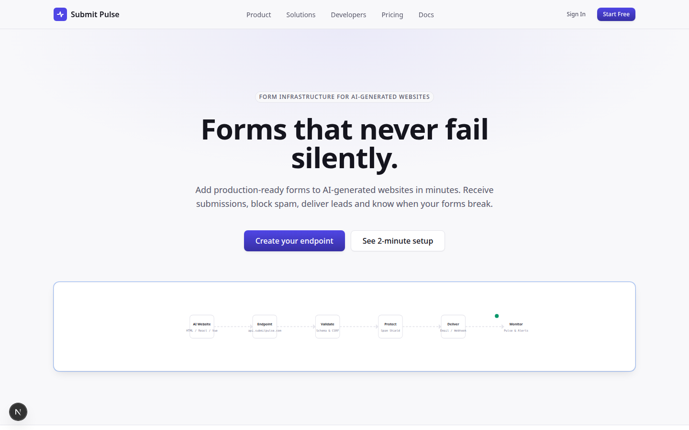
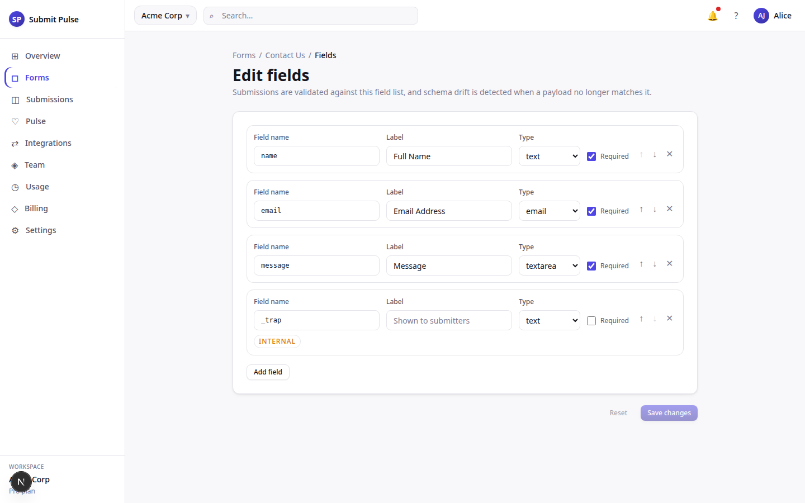

# Submit Pulse

Form infrastructure for AI-generated and static websites. Website owners point their form's `action` attribute or JavaScript `fetch` call at a Submit Pulse endpoint. The platform handles receipt, spam filtering, delivery, and monitoring.

Tagline: "Forms that never fail silently."

---

## Screenshots



*The marketing site — forms that never fail silently.*



*The dashboard fields editor — submissions are validated against this field list, and schema drift is detected when a payload no longer matches it.*

---

## Current status

**First verification pass completed 2026-11-12** (Node 24, pnpm 10.34.5): dependencies install cleanly (`pnpm-lock.yaml` is now committed), and typecheck, lint, unit tests, and the web build have all been run for the first time. Results below are observed, not aspirational. **No database has been provisioned. No external credentials exist. The product is not running anywhere.**

Verification results:

- **Install:** `pnpm install` completes for all 20 workspace projects.
- **Typecheck:** 12 of 20 packages typecheck clean. **36 errors remain** across 8 packages (web 22, billing 6, ingest 3, and 1 each in auth, mcp, testing, ui, worker). Down from 256 errors at first run; the remaining ones are per-site code issues, not configuration.
- **Lint:** ESLint did not exist in this repo at all (no binary, no config); a shared flat config now lives at `eslint.config.mjs`. **16 of 17 lint tasks pass.** `apps/web` fails on exactly 3 unused variables, each of which marks logic that is computed but never wired in (see Known issues) — they were left in place deliberately rather than deleted to silence the linter.
- **Unit tests:** 211 tests run, **210 pass, 1 fails**. The failure is a genuine semantic disagreement (see Known issues). The billing and config test suites (77 tests) previously never ran — they had test files but no test script; they are wired now and pass. `apps/web` has **zero unit tests**; its `e2e/` Playwright specs are `test.fixme()` stubs and have still never been executed (browsers not installed). The k6 load-test scripts remain authored intent only.
- **Build:** Only `apps/web` has a build script (every package is consumed as TypeScript source). Webpack compilation **succeeds**; `next build` then stops at its lint gate on the same 3 variables above, before reaching its type-check gate. The production build has not yet completed end to end.
- **CI:** `.github/workflows/ci.yml` runs install + typecheck + lint + test on push/PR. It is expected to be red until the remaining items below are resolved — that is the point of the baseline.

Known issues found by the first verification pass:

- **Origin allowlist semantics conflict (the 1 failing test):** `packages/security/src/origin.ts` and its documentation say an `includeSubdomains` entry still matches its own base host exactly; the test `rejects wildcard.io itself when only the sub entry has includeSubdomains` in `apps/ingest/src/__tests__/origin.test.ts` asserts the opposite. One of them must change; this is a product decision, so both were left untouched.
- **Unwired OAuth PKCE:** `apps/web/src/app/(auth)/auth/callback/route.ts` reads the `codeVerifier` from the PKCE cookie but never passes it to the token exchange (the file's own comment describes the intended call). This is the largest single reason web lint stays red.
- **Unwired permission gates:** the integrations and team pages compute `canManage` / `canInvite` permission checks but never use them to gate the UI.
- **Undefined name:** `apps/web/src/app/(admin)/admin/workspaces/WorkspaceActions.tsx` references `FIXTURE_OPS_EMAIL`, which is not defined anywhere (2 type errors).
- **Unsafe casts in billing:** `packages/billing/src/webhook-handler.ts` casts `Record<string, unknown>` directly to Stripe object types in 5 places (TS2352); they need `unknown` intermediates and runtime shape checks.
- **`exactOptionalPropertyTypes` friction:** several call sites pass explicit `undefined` to optional properties (auth, ingest, mcp, testing, web layouts/CodeBlock). Each needs a per-site decision: omit the key, or widen the target type.

Still true from the original assessment:

- The schema in `packages/database/src/schema/` defines 34 tables and 96 RLS policies. The SQL migration has never been applied to any Postgres instance.
- All external services (Supabase, Stripe, Resend, Cloudflare Turnstile, Upstash Redis, Cloudflare R2) are referenced by interface only. Dev-bypass drivers exist for captcha and email; everything else is a stub or placeholder.
- The dashboard renders hardcoded fixture data. No database queries are wired to any UI route.
- `apps/ingest/src/repository/d1-form-repository.ts` — the production form lookup — contains unimplemented SQL stubs.
- All eight `apps/worker/src/handlers/` exist as shells. Seven are stubs. `deliver-webhook` makes an HTTP call but all database writes are TODO comments.
- `wrangler.toml` contains literal placeholders: `REPLACE_WITH_D1_DATABASE_ID`, `REPLACE_WITH_KV_NAMESPACE_ID`.

What is implemented and internally consistent:

- Full database schema (34 tables, 18 enums, constraints, indexes, RLS policies) as TypeScript/Drizzle definitions and SQL.
- Permission matrix (`packages/auth/src/permissions.ts`) — exhaustive by construction; all four roles defined.
- Entitlement engine (`packages/config/src/entitlements.ts`) — plan limits, feature flags, quota checks.
- SSRF egress guard (`packages/security/src/ssrf.ts`).
- File validation pipeline (`packages/security/src/file-validation.ts`).
- Webhook signing and verification (`packages/webhooks/src/signing.ts`).
- Snippet and integration-prompt generators (`packages/config/src/snippets.ts`, `integration-prompts.ts`).
- Analytics aggregation helpers (`packages/analytics/src/index.ts`).
- Builder registry (`packages/config/src/builders.ts`) — 10 builders including Lovable, Bolt, v0, Cursor, Claude Code.
- Ingestion pipeline structure (`apps/ingest/src/`) — all 10 stages wired; dev repository works for local simulation.
- Email templates (`packages/email/src/templates/`).
- Browser SDK (`packages/sdk/src/`) — full implementation: `createClient`, retry logic, discriminated error types, idempotency helpers.
- React SDK (`packages/react/src/`) — `SubmitPulseProvider`, `useSubmitPulseForm`, `SubmitPulseForm`, `SubmitButton`, `FormStatus`.
- MCP server (`apps/mcp/src/`) — 2 of 7 tools fully functional (`generate_integration`, `validate_integration`); 5 INCOMPLETE.
- Brand module (`packages/config/src/brand.ts`) — single source of truth for all product identifiers.

---

## Monorepo layout

```
submit-pulse/
├── apps/
│   ├── ingest/          # Cloudflare Workers — public form submission endpoint (Hono)
│   ├── mcp/             # MCP server for AI coding agent integration
│   ├── web/             # Next.js 15 App Router — dashboard, marketing, onboarding, admin
│   └── worker/          # Cloudflare Workers queue consumer — notifications, webhooks
├── packages/
│   ├── analytics/       # Aggregation helpers (pure functions, no DB calls)
│   ├── auth/            # Session helpers, permission matrix, Supabase provider (stub)
│   ├── billing/         # Stripe integration (package placeholder — no source files)
│   ├── config/          # Brand, entitlements, builders, snippets, integration prompts
│   ├── database/        # Drizzle schema (34 tables), SQL migration, RLS
│   ├── email/           # Email provider interface, Resend driver, 6 email templates
│   ├── react/           # @submitpulse/react — React hook and component wrappers
│   ├── sdk/             # @submitpulse/browser — browser SDK (createClient, errors, idempotency)
│   ├── security/        # SSRF guard, origin check, rate limiter, captcha, file validation
│   ├── testing/         # Test utilities (fixtures, random data, actor helpers, tenant isolation)
│   ├── ui/              # Design tokens, Tailwind preset, component library
│   ├── validation/      # JSON Schema validator
│   └── webhooks/        # Signing, events, retry, delivery
├── load-tests/          # k6 scripts (5 scripts; never run)
├── .github/workflows/   # CI (ci.yml, e2e.yml, codeql.yml) — never passed
├── docs/                # Full documentation set
├── pnpm-workspace.yaml
├── turbo.json
└── tsconfig.base.json
```

---

## Prerequisites

These tools are required. None have been used in the current environment.

| Tool | Version | Purpose |
|---|---|---|
| Node.js | 22 | Runtime |
| pnpm | 10.34.5 | Package manager |
| Wrangler CLI | Latest | Cloudflare Workers deployment |
| k6 | 0.51+ | Load testing |

External accounts required: Cloudflare (Workers, D1, KV, Queues, R2, Turnstile), Supabase, Stripe, Resend, Upstash.

---

## Local setup (intended — not verified)

```bash
# 1. Install dependencies (requires npm registry access)
pnpm install

# 2. Copy and fill in environment variables
cp apps/web/.env.example apps/web/.env.local
# Fill in all variables — see docs/38-environment-variables.md

# 3. Start the web dashboard
pnpm --filter @submitpulse/web dev

# 4. Start the ingestion worker (Wrangler local mode)
pnpm --filter @submitpulse/ingest dev

# 5. Start the queue worker
pnpm --filter @submitpulse/worker dev
```

In development mode, the ingestion service uses a fixture form repository and bypasses CAPTCHA. The dashboard renders fixture data. No external services are required for local development in this mode.

---

## Environment variables

All variables are prefixed with `SP_`. Client-exposed variables additionally use the Next.js convention `NEXT_PUBLIC_`.

| Variable | Service | Required for |
|---|---|---|
| `SP_SUPABASE_URL` | Supabase | Database and auth |
| `SP_SUPABASE_ANON_KEY` | Supabase | Client-side auth |
| `SP_SUPABASE_SERVICE_ROLE_KEY` | Supabase | Server-side queries (never expose to client) |
| `SP_STRIPE_SECRET_KEY` | Stripe | Billing |
| `SP_STRIPE_WEBHOOK_SECRET` | Stripe | Webhook signature verification |
| `SP_RESEND_API_KEY` | Resend | Email delivery |
| `SP_TURNSTILE_SECRET_KEY` | Cloudflare Turnstile | CAPTCHA verification (Wrangler secret) |
| `SP_UPSTASH_REDIS_REST_URL` | Upstash | Rate limiting (Wrangler secret) |
| `SP_UPSTASH_REDIS_REST_TOKEN` | Upstash | Rate limiting (Wrangler secret) |
| `NEXT_PUBLIC_SP_SUPABASE_URL` | Supabase | Browser auth client |
| `NEXT_PUBLIC_SP_SUPABASE_ANON_KEY` | Supabase | Browser auth client |
| `NEXT_PUBLIC_SP_TURNSTILE_SITE_KEY` | Cloudflare Turnstile | Browser CAPTCHA widget |

See `docs/38-environment-variables.md` for the complete list.

---

## Testing

**No tests have run. No test results exist.**

Test infrastructure that exists:

- **Unit tests**: Vitest. Files in `apps/ingest/src/__tests__/` and `packages/config/src/__tests__/`.
- **E2E tests**: Playwright. Files in `apps/web/e2e/`. 22 tests marked `test.fixme()`.
- **Load tests**: k6. Scripts in `load-tests/`. None have been executed.
- **CI**: GitHub Actions workflows in `.github/workflows/`. 9 CI jobs + E2E workflow + CodeQL. None have passed.

To run tests once dependencies are installed:

```bash
pnpm test                    # unit tests
pnpm turbo run test:integration  # integration tests
cd apps/web && pnpm exec playwright test  # E2E
k6 run load-tests/submission-sustained.js  # load test (requires deployed worker)
```

---

## Documentation

Full documentation is in `docs/`. Start with `docs/40-known-limitations.md` for an honest gap analysis, then `docs/01-product-overview.md` for what the product is intended to do.

Key documents:

| Document | Contents |
|---|---|
| `docs/40-known-limitations.md` | Everything that doesn't work; all stubs and missing implementations |
| `docs/39-release-checklist.md` | Complete task list before deployment |
| `docs/09-architecture.md` | System topology and component responsibilities |
| `docs/10-database-schema.md` | All 34 tables, RLS model, enums |
| `docs/22-sdk.md` | Browser SDK and React SDK API reference |
| `docs/21-mcp-server.md` | MCP server tools, scopes, and constraints |
| `docs/33-admin-guide.md` | 14 admin routes, escalation flow |
| `docs/38-environment-variables.md` | All environment variables |
